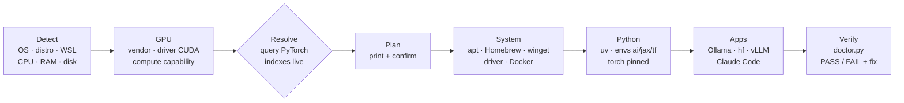

<div align="center">

# ⚡ AIStrap

### One command. A complete, GPU-ready AI workstation.

Bootstrap a fresh Ubuntu, WSL2, macOS or Windows machine into a modern AI/ML environment with GPU drivers, the right PyTorch build, the Hugging Face stack, local LLMs and containers.<br>
**Nothing is pinned:** every run resolves the newest versions your hardware can actually run.

[](https://github.com/brandonjabr/aistrap/actions/workflows/ci.yml)
[](LICENSE)


-3776ab)

[Quick start](#-quick-start) •
[What you get](#-what-you-get) •
[How it works](#-how-it-works) •
[Usage](#-usage) •
[Reference](#-reference) •
[Troubleshooting](#-troubleshooting) •
[FAQ](#-faq)

</div>

---

## 🚀 Quick start

**Linux · WSL2 · macOS**

```bash
curl -fsSL https://raw.githubusercontent.com/brandonjabr/aistrap/master/install.sh | bash
```

**Windows** (PowerShell)

```powershell
irm https://raw.githubusercontent.com/brandonjabr/aistrap/master/install.ps1 | iex
```

> [!TIP]
> **Preview first.** Add `--dry-run` (Windows: `-DryRun`). AIStrap detects your hardware, picks the builds, and prints the full plan and every command without changing anything.

When it finishes, open a new terminal:

```bash
ai                 # activate the main environment
aistrap doctor     # prove the GPU works (with a quick benchmark)
aistrap lab        # JupyterLab, with a kernel for every environment
```

---

## 💡 Why AIStrap

Setting up a machine for AI used to mean installing CUDA and cuDNN by hand, matching versions from forum threads, and compiling frameworks from source. AIStrap began in 2017 as **UbuntuDL**, a script that did all of that for Ubuntu 16.04 + CUDA 8 + Caffe. It hard-coded every version, so it stopped working as soon as anything upstream moved.

The landscape has changed, and so have the hard parts:

| | Then | Now |
|---|---|---|
| **GPU stack** | Install CUDA + cuDNN by hand behind a registration wall | Wheels bundle CUDA. You need a driver and the *right wheel variant* |
| **Python** | `sudo pip install` into the system Python 2.7 | Isolated envs with [uv](https://docs.astral.sh/uv/): managed Python, 10–100× faster than pip |
| **Frameworks** | Compile Caffe for an hour | `pip`-installable; the work is picking *compatible* builds |
| **Environments** | One env where every library fights | One env per framework (PyTorch, JAX and TF pin conflicting CUDA libs) |
| **Workflow** | Training scripts | Local LLMs, model hubs, LLM APIs, agents, GPU containers, experiment tracking |
| **Platforms** | Ubuntu only | Linux, WSL2, macOS (Metal + MLX) and Windows |

### Resolve, don't pin

Hard-coded versions break within months. On the day this release was written:

- the `cu132` PyTorch index had **torch 2.15**, while `cu128` stopped at **2.11** and `cu126` had **2.14.1**;
- `torchaudio` was **four releases behind** torch, so installing it would have silently downgraded PyTorch;
- **RTX 50-series (Blackwell)** cards need CUDA 12.8+ builds, while **CUDA 13 dropped Pascal and Volta**, so a GTX 1080 Ti must stay on `cu126`.

AIStrap handles all of this at install time. It reads your driver's CUDA level and your GPU's compute capability, queries the live PyTorch indexes, and installs **the newest PyTorch your exact hardware can run**. Run `aistrap update` later and it re-resolves everything.

---

## 🎁 What you get

<table>
<tr>
<td width="50%" valign="top">

### ⏱️ An afternoon back
A fresh box goes from nothing to *training on the GPU in Jupyter* in one unattended run. You answer one prompt (or none with `--yes`).

### 🎯 The right build, automatically
CUDA, ROCm, Intel XPU, Apple MPS or CPU, matched to your driver **and** your GPU architecture.

### 🧱 No dependency hell
Every framework gets its own uv environment. PyTorch is pinned with a constraints file, so a later `pip install` can never swap it for a CPU build.

</td>
<td width="50%" valign="top">

### 🩺 Proof it works
`aistrap doctor` confirms each framework can see the accelerator, benchmarks a matmul in TFLOPS, and tells you exactly how to fix anything wrong.

### 🔄 Always current
`aistrap update` re-detects and upgrades in place. A weekly CI job runs against live upstream, so breakage shows up in CI before it reaches you.

### ↩️ Safe and reversible
Dry runs, a printed plan, every command echoed, full logs, safe re-runs, and `aistrap uninstall` to remove it all cleanly.

</td>
</tr>
</table>

### Profiles

Choose with `--profile` (Windows: `-Profile`). **standard** is the default.

| Component | minimal | standard | full |
|---|:-:|:-:|:-:|
| **GPU driver** (Ubuntu, via `ubuntu-drivers`) / **Homebrew** dev tools (macOS) | ✅ | ✅ | ✅ |
| **System tools:** build-essential, cmake, ninja, git-lfs, ffmpeg, tmux, ripgrep, jq, btop, nvtop | ✅ | ✅ | ✅ |
| **uv** + managed **Python 3.12** | ✅ | ✅ | ✅ |
| **PyTorch + torchvision**, best build for your hardware | ✅ | ✅ | ✅ |
| **Scientific Python:** NumPy, SciPy, pandas, Polars, PyArrow, scikit-learn, Matplotlib, Seaborn, Plotly | ✅ | ✅ | ✅ |
| **JupyterLab** + ipywidgets, with a kernel per environment | ✅ | ✅ | ✅ |
| **Hugging Face:** transformers, datasets, accelerate, PEFT, TRL, diffusers, sentence-transformers, timm, evaluate | | ✅ | ✅ |
| **LLM SDKs:** anthropic, openai, mcp, ollama | | ✅ | ✅ |
| **ML toolkit:** XGBoost, LightGBM, ONNX Runtime, OpenCV, Gradio, einops, bitsandbytes (NVIDIA) | | ✅ | ✅ |
| **Experiment tracking:** Weights & Biases, MLflow, TensorBoard | | ✅ | ✅ |
| **MLX + mlx-lm** (Apple Silicon) | | ✅ | ✅ |
| **`hf` CLI** for models and datasets | | ✅ | ✅ |
| **Ollama:** run local LLMs | | ✅ | ✅ |
| **Docker + NVIDIA Container Toolkit** (Linux) | | ✅ | ✅ |
| **JAX env:** JAX (CUDA 12/13 plugin picked automatically), Flax, Optax, Orbax | | | ✅ |
| **TensorFlow env:** TensorFlow (`[and-cuda]` on Linux) + Keras 3 | | | ✅ |
| **vLLM:** OpenAI-compatible inference server (Linux + NVIDIA) | | | ✅ |
| **Claude Code:** AI coding agent in your terminal | | | ✅ |
| **Extras:** Lightning, Optuna, CatBoost, statsmodels, DuckDB, SHAP, mlx-vlm | | | ✅ |
| *Approx. disk needed* | *~8 GB* | *~15 GB* | *~45 GB* |

Mix and match on any profile: `--jax`, `--tensorflow`, `--vllm`, `--claude-code`, `--vscode`, `--docker`, `--cuda-toolkit`, or drop things with `--no-ollama`, `--no-docker` and so on.

### Platform support

| Platform | Accelerators | Notes |
|---|---|---|
| 🐧 **Ubuntu** 22.04 · 24.04 · 26.04 (x86_64 + arm64) | NVIDIA CUDA · AMD ROCm · Intel XPU · CPU | Installs the recommended NVIDIA driver; reboot once afterwards. Debian, Mint and Pop!_OS work too. |
| 🪟 **WSL2** (Windows 10/11) | NVIDIA CUDA | Uses the Windows driver; nothing to install inside Linux. **Best option on Windows.** |
| 🍎 **macOS 14+** on Apple Silicon | Metal (MPS) · MLX | Homebrew, Ollama as a background service, llama.cpp. Intel Macs aren't supported by PyTorch. |
| 🪟 **Windows** 10/11 native | NVIDIA CUDA · Intel XPU · CPU | PyTorch on GPU. JAX and TF are CPU-only on native Windows (upstream); use `-WSL` for GPU. |
| 🐧 Other Linux (Fedora, Arch, …) | any | Python layer works. Install system packages and drivers yourself (`--no-system`). |

---

## ⚙️ How it works



### Picking the PyTorch build

| Your hardware | Indexes considered | Chosen |
|---|---|---|
| NVIDIA, driver CUDA *X.Y* | every `cuXYZ` ≤ your driver, from `cu126` up | the index with the **newest torch**; ties go to the newer CUDA |
| NVIDIA Blackwell (compute ≥ 10.0) | only `cu128` and newer | old drivers get a clear "update to 570+" message |
| NVIDIA Pascal/Volta (compute < 7.5) | capped at `cu126` | CUDA 13 builds have no kernels for these cards |
| NVIDIA with a very old driver | falls back to `cu124`, `cu121`, `cu118` | with a warning to update |
| AMD Radeon / Instinct | `rocm7.x`, `rocm6.4` | newest torch |
| Intel Arc | `xpu` | |
| Apple Silicon | PyPI (Metal built in) | MPS |
| No GPU | `cpu` | avoids downloading ~3 GB of unused CUDA libraries |

### Design principles

- **Resolve, don't pin.** Versions come from live indexes and your hardware, never from constants.
- **Isolate.** Nothing touches the system Python. Frameworks with conflicting CUDA pins get separate envs.
- **Degrade gracefully.** If one optional package can't resolve, it's skipped and reported. The install carries on.
- **Idempotent.** Re-running upgrades in place. If the best backend changes (for example after a driver upgrade), PyTorch is reinstalled to match.
- **Transparent.** `--dry-run`, a printed plan, every command echoed, and a full log.
- **Reversible.** Everything lives in `~/.aistrap` plus one marked block in your shell rc.

### What goes where

```
~/.aistrap/
├── envs/
│   ├── ai/            PyTorch + the full stack (activate with `ai`)
│   ├── jax/           JAX + Flax + Optax          (full or --jax)
│   └── tf/            TensorFlow + Keras 3        (full or --tensorflow)
├── bin/aistrap        the helper CLI (symlinked into ~/.local/bin)
├── doctor.py          the health check
├── install.sh         cached installer, used by `aistrap update` offline
├── state.env          detected backend, profile and your original flags
└── logs/              one log per install run
```

Plus `uv tool` installs (`hf`, `vllm`), Jupyter kernels named `aistrap-*`, and a `# >>> aistrap >>>` block in `~/.bashrc` / `~/.zshrc`.

---

## 🧑‍💻 Usage

### Install options

```bash
# Pass options through curl | bash with "bash -s --"
curl -fsSL https://raw.githubusercontent.com/brandonjabr/aistrap/master/install.sh | bash -s -- --profile full --yes

# Or from a clone
git clone https://github.com/brandonjabr/aistrap && cd aistrap
./install.sh --dry-run                      # preview the plan
./install.sh --profile minimal              # lean install
./install.sh --jax --no-docker              # standard + JAX, without Docker
./install.sh --no-system                    # Python stack only (no sudo needed)
./install.sh --backend cpu                  # force a specific PyTorch build
```

```powershell
.\install.ps1 -Profile full                 # native Windows
.\install.ps1 -WSL                          # enable WSL2, install Ubuntu, run the Linux installer inside
.\install.ps1 -DryRun                       # preview
```

### Everyday commands

| Command | What it does |
|---|---|
| `ai` | Activate the main env (`python`, `jupyter`, all libraries) |
| `aistrap doctor [env…]` | Health check: accelerator, versions, matmul benchmark, fixes |
| `aistrap lab` | Start JupyterLab with kernels for `ai`, `jax`, `tf` |
| `aistrap shell [env]` | Open a shell with an env active (default `ai`) |
| `aistrap run ENV CMD…` | Run one command inside an env |
| `aistrap add [-e ENV] PKG…` | Add packages without disturbing the pinned PyTorch build |
| `aistrap envs` | List envs and their framework versions |
| `aistrap update` | Re-detect and upgrade everything to the newest compatible builds |
| `aistrap uninstall [-y]` | Remove envs, helper, kernels and shell config |
| `aistrap version` | Show version, backend and profile |

### Recipes

<details>
<summary><b>Chat with a local LLM</b></summary>

```bash
ollama run gemma3                      # any model from ollama.com/library
```
From Python (`ai` env), with the `ollama` SDK:
```python
import ollama
print(ollama.chat(model="gemma3", messages=[{"role": "user", "content": "Hello!"}])["message"]["content"])
```
</details>

<details>
<summary><b>Serve an OpenAI-compatible API with vLLM</b> (Linux + NVIDIA, <code>full</code> or <code>--vllm</code>)</summary>

```bash
vllm serve Qwen/Qwen3-8B               # listens on http://localhost:8000/v1
```
```python
from openai import OpenAI
client = OpenAI(base_url="http://localhost:8000/v1", api_key="local")
print(client.chat.completions.create(model="Qwen/Qwen3-8B",
      messages=[{"role": "user", "content": "Hi"}]).choices[0].message.content)
```
</details>

<details>
<summary><b>Fine-tune with LoRA (PEFT + TRL)</b></summary>

```python
from datasets import load_dataset
from peft import LoraConfig
from trl import SFTConfig, SFTTrainer

trainer = SFTTrainer(
    model="Qwen/Qwen3-0.6B",
    train_dataset=load_dataset("trl-lib/Capybara", split="train[:1%]"),
    peft_config=LoraConfig(r=16, lora_alpha=32, target_modules="all-linear"),
    args=SFTConfig(output_dir="qwen-lora", max_steps=50),
)
trainer.train()
```
</details>

<details>
<summary><b>Run LLMs natively on Apple Silicon with MLX</b></summary>

```bash
ai
mlx_lm.generate --model mlx-community/Qwen3-4B-4bit --prompt "Explain attention in one paragraph"
```
</details>

<details>
<summary><b>GPU inside Docker</b> (Linux + NVIDIA)</summary>

```bash
docker run --rm --gpus all ubuntu nvidia-smi
```
</details>

<details>
<summary><b>Download models and datasets</b></summary>

```bash
hf download Qwen/Qwen3-8B
hf download --repo-type dataset HuggingFaceFW/fineweb --include "sample/10BT/*"
```
</details>

### Health check

`aistrap doctor` output from a real run on a 2021 MacBook Pro (M1 Pro):

```
AIStrap doctor - env 'ai'
  PASS  Platform               Darwin 25.6.0 arm64
  PASS  PyTorch                2.8.0 (CPU/MPS build)
  PASS  Accelerator            Apple Metal (MPS) available
  PASS  Matmul benchmark       3.6 TFLOPS (float16, 4096x4096, Apple GPU (Metal))
  All good.
```

When something is wrong, it tells you what to do:

```
  FAIL  Expected backend       installer set up 'cuda', but PyTorch is using 'cpu'
  What to fix:
   - No CUDA device visible. If the NVIDIA driver was just installed, reboot. ...
```

---

## 📖 Reference

### `install.sh` options

| Option | Description |
|---|---|
| `-p, --profile NAME` | `minimal`, `standard` (default) or `full` |
| `--jax` / `--no-jax` | Separate JAX environment |
| `--tensorflow` / `--no-tensorflow` | Separate TensorFlow + Keras environment |
| `--vllm` / `--no-vllm` | vLLM server (Linux + NVIDIA only) |
| `--ollama` / `--no-ollama` | Ollama local LLM runtime |
| `--docker` / `--no-docker` | Docker Engine (+ NVIDIA Container Toolkit); Docker Desktop on macOS |
| `--claude-code` / `--no-claude-code` | Claude Code CLI |
| `--vscode` | Visual Studio Code |
| `--cuda-toolkit` | Full CUDA toolkit (`nvcc`). Only needed to compile custom CUDA kernels |
| `--backend NAME` | Force a PyTorch build: `cpu`, `mps`, `xpu`, `cu130`, `rocm7.2`, … |
| `--python X.Y` | Python version for the envs (default `3.12`, minimum `3.11`) |
| `--no-driver` | Don't install the NVIDIA driver |
| `--no-system` | Skip OS packages (apt/Homebrew); build only the Python stack, no sudo |
| `--system-upgrade` | Run a full `apt upgrade` first |
| `--no-shell-config` | Don't add the `ai` alias / PATH block to your shell rc |
| `--home DIR` | Install location (default `~/.aistrap`) |
| `-y, --yes` | Don't ask for confirmation |
| `-n, --dry-run` | Detect and print the plan + commands; change nothing |
| `--doctor` | Run the health check on an existing install |
| `--uninstall` | Remove the environments and shell config |
| `-h, --help` · `-V, --version` | Help and version |

### `install.ps1` parameters

| Parameter | Description |
|---|---|
| `-Profile NAME` | `minimal`, `standard` (default) or `full` |
| `-WSL` · `-Distro NAME` | Set up WSL2 + Ubuntu (default `Ubuntu-24.04`) and run the Linux installer there |
| `-Jax` · `-TensorFlow` · `-ClaudeCode` · `-VSCode` · `-NoOllama` | Toggle components |
| `-Backend NAME` · `-Python X.Y` · `-InstallDir DIR` | Same as the Linux options |
| `-Yes` · `-DryRun` · `-NoShellConfig` | Same as the Linux options |

### Environment variables

| Variable | Purpose |
|---|---|
| `AISTRAP_HOME` | Install location (same as `--home`) |
| `AISTRAP_REPO_RAW` | Fetch the installer and assets from a fork or branch |
| `AISTRAP_SIMULATE_GPU` | Testing: pretend the GPU is `nvidia:13.0:12.0` (vendor:driverCUDA:compute), `amd`, `intel` or `none` |
| `NO_COLOR` | Disable colored output |

---

## 🛠️ Troubleshooting

<details>
<summary><b><code>aistrap doctor</code> says FAIL right after install (NVIDIA, Linux)</b></summary>

The driver's kernel module loads at boot. Reboot, then run `aistrap update` so AIStrap re-detects the GPU and picks the best build. If **Secure Boot** is on, a blue "Perform MOK management" screen appears on reboot: choose *Enroll MOK* and enter the password you set during install.
</details>

<details>
<summary><b>"This PyTorch build has no kernels for sm_XX"</b></summary>

The installed build doesn't support your GPU's architecture. This usually happens on a fresh install where the compute capability couldn't be read yet. Run `aistrap update`, or force a build with `./install.sh --backend cu128` (Blackwell) or `--backend cu126` (Pascal/Volta).
</details>

<details>
<summary><b>"torch needs CUDA X, driver supports Y"</b></summary>

Your driver is older than the build. Update the driver (`sudo ubuntu-drivers install` on Ubuntu, or the NVIDIA App on Windows/WSL), then run `aistrap update`.
</details>

<details>
<summary><b>AMD GPU not detected (ROCm)</b></summary>

Log out and back in so the `render` and `video` group membership applies. Check that your card is on AMD's ROCm support list. For unsupported cards, use `--backend cpu`.
</details>

<details>
<summary><b>Docker says permission denied</b></summary>

Log out and back in (you were added to the `docker` group), or run `newgrp docker` in the current shell.
</details>

<details>
<summary><b>Windows: <code>ai</code> isn't recognized in PowerShell</b></summary>

PowerShell's execution policy is blocking your profile. `aistrap` still works through `aistrap.cmd`. To enable `ai` too, run:
```powershell
Set-ExecutionPolicy -Scope CurrentUser RemoteSigned
```
</details>

<details>
<summary><b>Something failed halfway</b></summary>

The installer prints the failing line and the path to its log (`~/.aistrap/logs/`). Fix the cause and re-run the same command: finished steps are skipped or upgraded in place.
</details>

---

## ❓ FAQ

**Do I need the CUDA toolkit or cuDNN?**
No. PyTorch, JAX and TensorFlow wheels bundle the CUDA libraries they need; only the driver is required. Use `--cuda-toolkit` if you compile your own CUDA extensions.

**Can I keep using conda?**
Yes. AIStrap doesn't touch conda. It uses uv because uv is much faster and reproducible.

**Will it mess with my system Python?**
No. Python is downloaded and managed by uv inside `~/.aistrap`.

**Where are Caffe, Theano and Torch7?**
Retired upstream years ago. PyTorch, JAX and Keras 3 cover what they did.

**Where's torchaudio?**
It's in maintenance mode and lags PyTorch releases, so installing it forces an older torch. If you need it, run `aistrap add torchaudio` and accept that trade-off.

**How do I add my own packages?**
`aistrap add <pkg>` (or `aistrap add -e jax <pkg>`). It keeps the PyTorch build pinned.

**How do I remove everything?**
`aistrap uninstall`. This removes the envs, helper, kernels and shell block. uv, system packages, drivers, Docker, Ollama and Homebrew stay; remove those with your package manager if you want.

---

## 🤝 Contributing

Issues and PRs are welcome. Useful tools while hacking:

```bash
./install.sh --dry-run --profile full                          # see every command
AISTRAP_SIMULATE_GPU=nvidia:12.8:12.0 ./install.sh --dry-run   # simulate a Blackwell GPU on an older driver
python3 doctor.py --expect cuda                                # run the health check directly
```

CI ([`.github/workflows/ci.yml`](.github/workflows/ci.yml)) runs shellcheck and the PowerShell parser, dry runs across Ubuntu 22.04/24.04/arm64 and macOS with simulated NVIDIA and AMD GPUs, and real CPU installs on Ubuntu and macOS. It runs weekly too, to catch upstream changes. Package lists live near the top of `install.sh` and `install.ps1`; keep them in sync.

## 📜 History

AIStrap started in 2017 as **UbuntuDL**, a one-command installer for TensorFlow, Caffe, Keras and PyTorch with CUDA 8 + cuDNN 5.1 on Ubuntu 16.04 and NVIDIA Pascal GPUs. It was based on Vu Manh Tu's Caffe install script. The original is preserved in [`legacy/`](legacy/UbuntuDL-setup-MASTER.sh). Version 2.0 is a complete rewrite under a new name.

## 📄 License

[MIT](LICENSE) © Brandon Jabr
